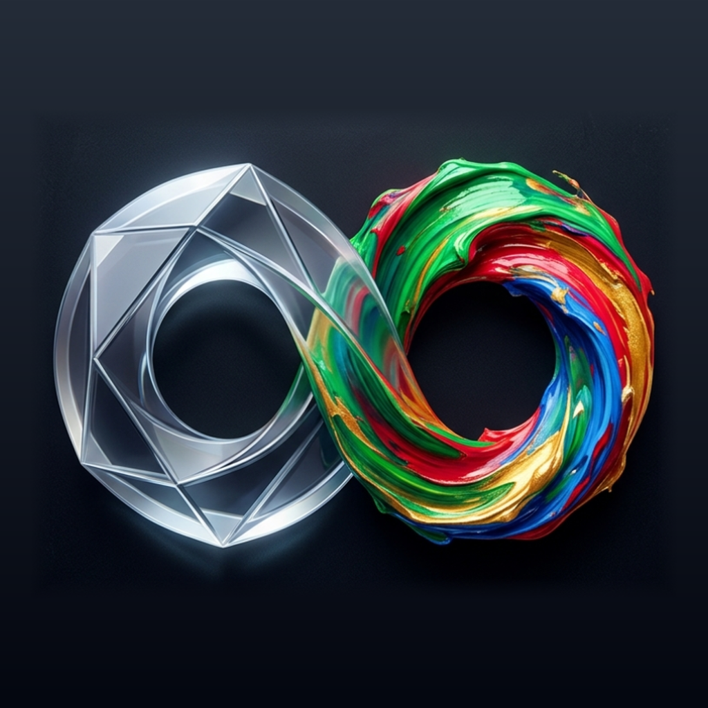
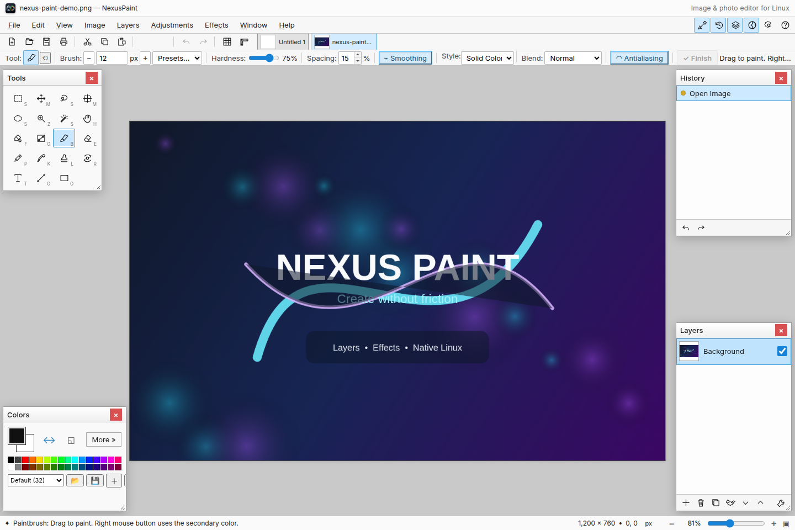
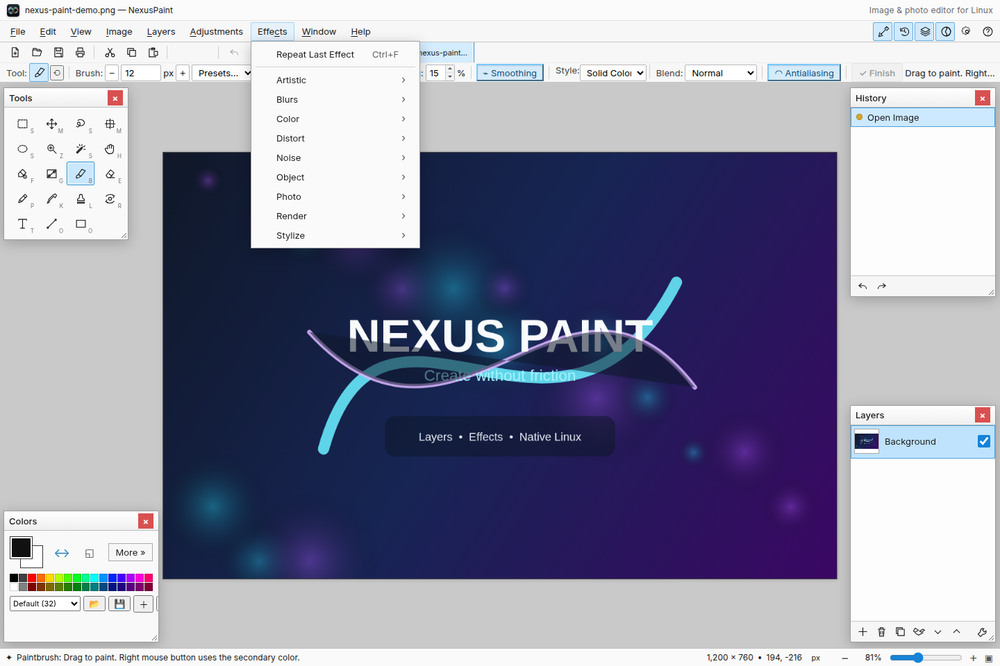

# NexusPaint

<p align="center">
  
</p>

NexusPaint is a fast, approachable, layer-based image editor built for Linux.
It combines a familiar desktop workflow with a modern, dependency-light
TypeScript and Tauri foundation.

> **Status:** NexusPaint is under active development. The latest preview is
> [version 0.7.7](https://github.com/agilize-nl/nexuspaint/releases/tag/v0.7.7).



## Highlights

- Multi-document, multi-layer editing with history and common blend modes
- Paintbrush, pencil, eraser, fill, gradient, clone, recolor, text and shape tools
- Rectangle, ellipse, lasso and magic-wand selections
- Built-in adjustments and effects with live previews
- Import and export support for common and professional raster formats
- Native Linux file dialogs, clipboard integration, scanning and printing
- Light and dark themes, pressure-sensitive pen input and familiar shortcuts
- Compact Linux desktop app powered by Tauri 2

<details>
  <summary>More of the interface</summary>

  
</details>

## Supported formats

NexusPaint works with PNG, JPEG, WebP, GIF, BMP, TGA, TIFF, DDS, AVIF and
layer-preserving `.nexuspaint` projects. Its native desktop codecs also support
importing formats such as JPEG XL, JPEG XR, HEIC/HEIF, ICO, HDR, EXR, PNM, QOI
and farbfeld.

## Platform

NexusPaint currently targets 64-bit Linux desktop systems. Download the current
[Debian package](https://github.com/agilize-nl/nexuspaint/releases/download/v0.7.7/NexusPaint_0.7.7_amd64.deb)
and install it on a Debian or Ubuntu-based distribution with:

```bash
sudo apt install ./NexusPaint_0.7.7_amd64.deb
```

Other versions and release notes are available on the
[Releases](https://github.com/agilize-nl/nexuspaint/releases) page.

## Project scope

This repository is the public home of NexusPaint and currently contains the
essential project information and screenshots. Source code and development
artifacts are not published here at this stage.

NexusPaint is an independent project and is not affiliated with or endorsed by
dotPDN LLC. Paint.NET is a trademark of its respective owner.

Copyright © Agilize
